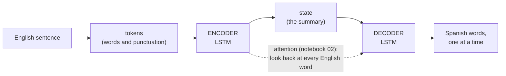
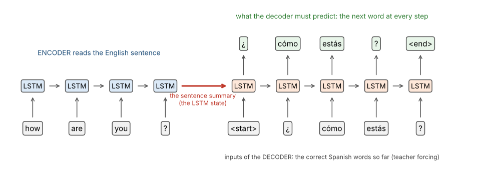
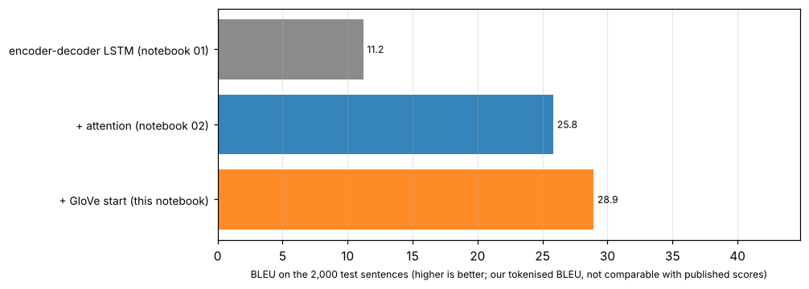
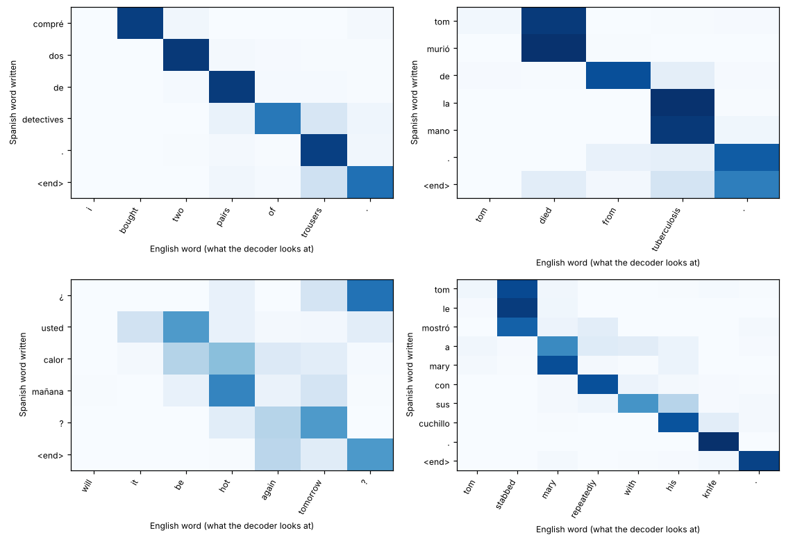

# From an encoder-decoder LSTM to attention and pretrained word vectors: English to Spanish translation

> **What this repository shows.** In 2023 I wrote a script to translate English into Spanish with an encoder-decoder network. It never translated a sentence and never measured its quality.
> Here the same idea is rebuilt as a path: **a leak-free split and a real metric first, then an encoder-decoder LSTM explained step by step (notebook 01, ready)**,
> then attention with a heat map (notebook 02, ready) and what pretraining can add (notebook 03, ready: pretrained word vectors; a pretrained translation model could not be run here), always on the same test sentences.

[](https://colab.research.google.com/github/maryammahmoudi1993/Translation-spanish-english/blob/master/notebooks/01_encoder_decoder_lstm_step_by_step.ipynb)

> **Status: the three notebooks are ready.** The comparison with a real *pretrained translation model* is **not done**: the hosts that serve such models are blocked in my environment (details in notebook 03, section 2).

## Who this is for

- **For:** learners who know basic Python and have seen an LSTM, and want to see a translation model built honestly, from data problems to a metric.
- **Not needed:** a GPU. Everything runs on a laptop CPU. **Time:** about 30 minutes for notebook 01 (training takes about twelve minutes) and about 45 minutes for notebook 02 (two trainings of about twelve minutes).

## What you will learn

- Why a split must group sentences by their source sentence, and how large the leak of a random split is here (20.5% of the test pairs).
- How text becomes numbers without damaging the language (accents stay).
- How an encoder-decoder works (teacher forcing in training, greedy decoding at translation time) and how to read BLEU honestly. (01)
- What attention is (scores, weights that add up to 1, a context vector), how to add it, how to compare two models fairly (same split, same settings, a paired bootstrap) and how to read an attention heat map with care. (02)

## The pipeline in one picture



<p align="center">
  <br>
  <em>The encoder-decoder with teacher forcing: the decoder is trained to predict the next Spanish word from the correct previous ones.</em>
</p>

## How to run

**In the browser:** click the Colab badge (the first cell downloads this repository and installs `sacrebleu`).

**On your computer** (Python 3.13 was tested):

```bash
git clone https://github.com/maryammahmoudi1993/Translation-spanish-english.git
cd Translation-spanish-english
python -m venv .venv
source .venv/bin/activate
pip install -r requirements.txt
python -m ipykernel install --user --name python3
jupyter lab notebooks/
```

If `jupyter` is not found, run `pip install jupyterlab` first (it is not needed to run the tests). Check that everything works (runs the smoke tests and the notebook, about forty minutes, because it trains three models):

```bash
python -m pytest -q
```

The data is the file `legacy/spa.txt` that was already in this repository; see [`data/README.md`](data/README.md) for its licence and attribution (CC-BY 2.0 France, Tatoeba).

## Contents

| # | Notebook | You will learn | Status |
|---|---|---|---|
| 01 | [The encoder-decoder, step by step](notebooks/01_encoder_decoder_lstm_step_by_step.ipynb) | the data and a leak-free split, tokens, the model, training on a CPU, greedy translation, BLEU | ready |
| 02 | [Attention and its heat map](notebooks/02_attention_and_its_heatmap.ipynb) | attention explained, the same model with attention, a fair comparison (BLEU, by length, paired bootstrap), what the decoder looks at | ready |
| 03 | [Pretrained word vectors, and an honest note on a pretrained translator](notebooks/03_pretrained_word_vectors_and_the_pretrained_model_question.ipynb) | what was blocked, GloVe vectors for the English side, the same fair comparison, one conclusion plot | ready |

Other folders: [`src/`](src) shared code, [`tests/`](tests) smoke tests and a test that runs every notebook, [`data/`](data) notes on the data,
[`legacy/`](legacy) the original 2023 files (untouched), [`assets/`](assets) figures with [credits](assets/CREDITS.md).

## Results so far

All numbers come from running the notebooks (seed 42, CPU, one run each). Training: 30,001 pairs (25,156 English sentences); test: 2,000 English sentences that share no sentence with the training data, scored against all their available Spanish translations.

| Model | BLEU | Exact match |
|---|---|---|
| copying the English words (a floor, not a translation) | 0.3 | - |
| encoder-decoder LSTM (256 units, 4.6 million parameters, 12 epochs) | 11.2 | 1.8% |
| the same model with attention (4.77 million parameters, 12 epochs) | 25.8 | 8.8% |
| **attention, English embeddings starting from GloVe vectors** (same size and settings) | **28.9** | **9.8%** |

BLEU by length of the English sentence, without and with attention: 14.4 and 25.5 (1-4 words), 12.0 and 27.6 (5-7 words), 10.3 and 24.1 (8-10 words). The difference of +14.6 BLEU has a 95% paired-bootstrap interval of +13.4 to +15.8 (it resamples the test sentences; the models were trained once each, with one seed). BLEU is computed with `sacrebleu` on lower-cased text split into words and punctuation marks (tokenisation "none"), so the scores are **not comparable with BLEU numbers in papers**.
The model produces Spanish-looking sentences that are often wrong in content (see the examples in the notebook). The validation loss of the baseline was still falling after 12 epochs, so it is not fully trained; the attention model reached a validation loss of 1.27 (baseline: 2.45) with 2.8% more parameters and about 10% more training time.

**Notebook 03.** Starting the English embedding table from pretrained GloVe vectors (50 of the 128 coordinates; still trained) gives +3.1 BLEU over notebook 02's model (95% paired-bootstrap interval +2.0 to +4.3; one training run per model). It is worse during the first five epochs and ahead from epoch 6 (final validation loss 1.18 against 1.27). The vectors are *pretrained embeddings*, not a pretrained translator.

<p align="center">
  <br>
  <em>One conclusion plot. There is no bar for a pretrained translation model because I could not run one.</em>
</p>

<p align="center">
  <br>
  <em>What the decoder looks at while it writes: mostly a diagonal, with jumps for questions (the opening question mark looks at the closing one). Looking at the right word does not guarantee writing the right word.</em>
</p>

## Then versus now

The table compares the 2023 script with this repository. The bar plot above puts the three models of today side by side.

| | **Then (January 2023, in [`legacy/`](legacy))** | **Now** |
|---|---|---|
| Spanish text | accented letters á é í ó ú ñ ü deleted ("dónde está" becomes "dnde est") | accents kept; words and punctuation marks are separate tokens |
| Vocabulary | built from the **test** split by mistake | built from the training sentences only |
| Split | random split of pairs, no seed; 20.5% of the test pairs would share their English sentence with the training data | split by English sentence with a fixed rule (no random numbers) |
| Evaluation | none (the script ends after `fit`; the "Evaluate and Translate" part described in the README does not exist) | greedy translation of unseen sentences, BLEU with several references, exact match, length analysis |
| Size | 1,024-unit GRUs, 15,000-word softmax, 15 epochs; hard-coded Windows path | 256-unit LSTMs, 6,000 and 8,000 words, 30,000 training pairs; runs on a CPU |
| Reproducibility | no seed | seed 42, smoke tests, CI |
| Pretraining | none | GloVe word vectors for the English embedding table (notebook 03); a pretrained translation model could not be run (blocked hosts) |

See [`legacy/ABOUT.md`](legacy/ABOUT.md) for what I notice in the original script today.

## Limitations

- **No pretrained translation model was run** (see notebook 03, section 2); the pretraining result is about word vectors only.
- Small models, 30,000 training pairs, 12 epochs, one seed per model: these are baselines, not translators, and results will change with other settings. The bootstrap interval covers the choice of test sentences, not the variation between training runs.
- Only sentences with at most 10 tokens are used; the model has never seen longer ones.
- BLEU (with tokenisation "none") is a crude measure; it does not capture meaning, and scores are not comparable with other work.
- The licence of the data is taken from the text inside the file (Tatoeba, CC-BY 2.0 France); I could not open the Tatoeba website to check it.

## Further reading

- Sutskever, Vinyals and Le (2014), *Sequence to Sequence Learning with Neural Networks*, <https://arxiv.org/abs/1409.3215> (the encoder-decoder).
- Luong, Pham and Manning (2015), *Effective Approaches to Attention-based Neural Machine Translation*, <https://arxiv.org/abs/1508.04025> (the dot-product attention used here).
- Bahdanau, Cho and Bengio (2015), *Neural Machine Translation by Jointly Learning to Align and Translate*, <https://arxiv.org/abs/1409.0473> (attention for translation).
- Pennington, Socher and Manning (2014), *GloVe: Global Vectors for Word Representation*, <https://aclanthology.org/D14-1162/> (the vectors of notebook 03).
- Papineni, Roukos, Ward and Zhu (2002), *BLEU: a Method for Automatic Evaluation of Machine Translation*, ACL 2002, <https://aclanthology.org/P02-1040/>.
- Post (2018), *A Call for Clarity in Reporting BLEU Scores*, <https://aclanthology.org/W18-6319/> (why scores must be computed in a stated way; `sacrebleu`).
- The Tatoeba project: <https://tatoeba.org>.

## License

MIT, see [`LICENSE`](LICENSE). The data has its own licence (CC-BY 2.0 France, with attribution), see [`data/README.md`](data/README.md).
